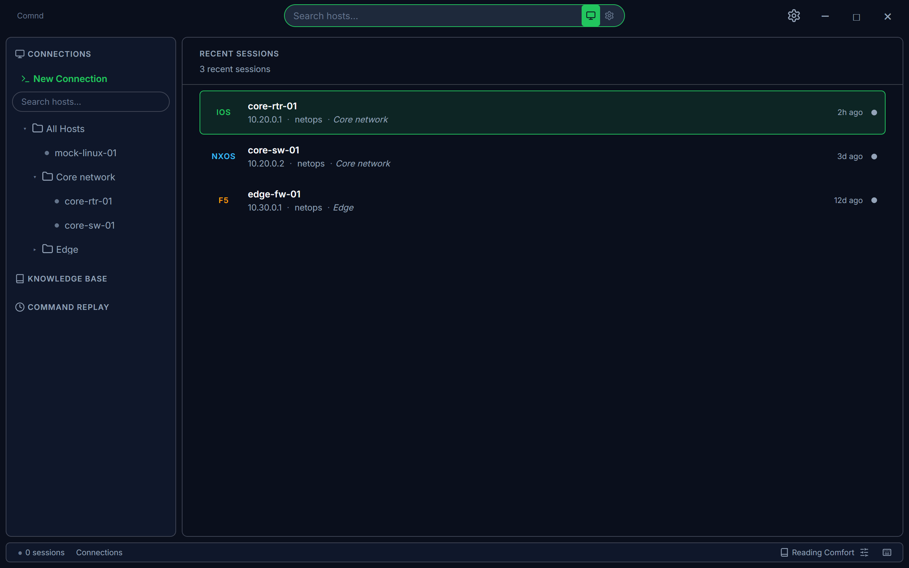
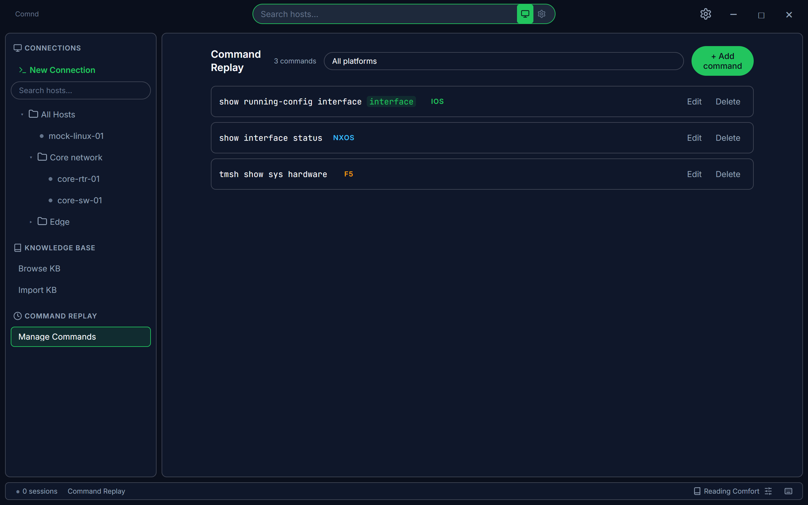

# Comnd

Comnd ("command") is a multi-platform desktop SSH client for network engineers.

- Suggests commands as you type, based on the device platform, the CLI mode you are in, and the software version.
- Takes suggestions from a knowledge base stored on your computer, so they work offline.
- Keeps your commands, terminal output and credentials on your machine.

[**Download Comnd**](https://github.com/bonzo81/comnd/releases/latest) · [Installation](docs/user-guide/01-installation.md) · [Documentation](#documentation) · [Contribute](CONTRIBUTING.md)

> **Development status:** Comnd is an early-stage app (pre-1.0) that is still being developed. Public releases are available to try, but features may change; it is not ready for production use. Builds are unsigned, so Windows or macOS may show first-launch security warnings. Review suggestions before you use them on important systems.

## Features

### Suggestions

Comnd combines the platform you set for the host with the prompt in front of you, so the choices match where you are.

- Matches on platform, CLI mode (`enable`/`config` on Cisco, `tmsh`/bash on F5) and software version.
- Ghost text completes inline as you type. Press **Tab** to accept it.
- **Ctrl+Space** opens a dropdown of every match, and the side panel shows the full syntax, parameters and examples for the highlighted command.
- No AI service is used for suggestions. The knowledge base is plain YAML that you can read, edit and extend.

### Terminal and sessions

The terminal stays a normal SSH terminal. Comnd adds to the view around it, never to the connection.

- When no suggestion is showing, **Tab** completes on the device as usual, so your normal shell habits keep working.
- Multiple sessions open in tabs, each with its own terminal state and session log.
- Output highlighting recolours IP addresses, interface names and status keywords. Interactive programs such as `vi`, `more` and `top` are left uncoloured.
- Optional session logging, with timestamps on each chunk of output.
- Fully keyboard-driven, including a **Reading Comfort** preset for dyslexic readers.
- Save commands with `{{variables}}` in Command Replay and send them again later.

### Hosts and credentials

Comnd is not another place where your hosts and passwords pile up.

- Use NetBox as the source of your host list and connect without re-entering anything. The integration is read-only.
- Keep credentials in your operating system keychain, an SSH agent, or Proton Pass, and associate a record with a host. No password is copied into the app.

### Knowledge base

The command data ships with the app, and it is yours to extend.

- Built-in commands for every platform listed under [Supported devices](#supported-devices), including category browsing and search.
- Add your own commands in YAML, or import them from vendor documentation with an LLM that you configure.
- Edit, disable or import entries without touching the built-in data.

## Screenshots

| Connection manager | Command Replay |
|---|---|
|  |  |

## Supported devices

Comnd runs on Windows, macOS and Linux. See the [installation guide](docs/user-guide/01-installation.md) for each platform's package format.

| Device platform | Typical devices |
|---|---|
| **Linux / bash** | Servers, VMs, Raspberry Pi, containers |
| **Cisco IOS-XE** | Routers, Catalyst switches, ASR, ISR |
| **Cisco NX-OS** | Nexus switches (3K/5K/7K/9K) |
| **F5 BIG-IP TMOS** | BIG-IP appliances and virtual editions |

## Get started

1. [Download the latest release](https://github.com/bonzo81/comnd/releases/latest) and follow the [installation guide](docs/user-guide/01-installation.md).
2. [Add your first host](docs/user-guide/02-getting-started.md). Enter the hostname and a username, then choose the platform — this field decides which commands you are offered.
3. Start typing. Press **Tab** to accept a suggestion, or keep typing to send your own command. [Terminal and Suggestions](docs/user-guide/04-terminal-and-suggestions.md) explains the matching rules.

## Documentation

| I want to… | Read |
|---|---|
| Install the app and connect to a device | [Install Comnd](docs/user-guide/01-installation.md) · [Getting Started](docs/user-guide/02-getting-started.md) · [Connecting to Devices](docs/user-guide/03-connecting-to-devices.md) |
| Use the terminal and the suggestion system | [Terminal and Suggestions](docs/user-guide/04-terminal-and-suggestions.md) · [Side Panel](docs/user-guide/05-side-panel.md) |
| Learn the keyboard shortcuts | [Keyboard Shortcuts](docs/user-guide/07-keyboard-shortcuts.md) · rebinding is in [Settings](docs/user-guide/08-settings.md) |
| Reuse saved commands | [Command Replay](docs/specs/09-command-replay.md) |
| Understand the knowledge base | [Knowledge Base Overview](docs/user-guide/06-knowledge-base-overview.md) · [Customizing the Knowledge Base](docs/user-guide/11-customizing-knowledge-base.md) · [schema and import](docs/specs/06-knowledge-base.md) · [custom KB design](docs/specs/10-custom-knowledge-base.md) |
| Check how credentials are stored | [Security](docs/user-guide/09-security.md) |
| Fix a problem | [Troubleshooting](docs/user-guide/10-troubleshooting.md) |
| See what is planned next | [Future and open questions](docs/specs/08-future-open-questions.md) |
| Build from source or run the test suites | [Development Setup](docs/DEVELOPMENT.md) · [manual test matrix](docs/testing/manual-matrix.md) |
| Contribute commands or code | [Contributing](CONTRIBUTING.md) |
| Understand the design | [Overview and goals](docs/specs/01-overview-goals.md) · [architecture](docs/specs/02-technical-architecture.md) · [decision records](docs/adr/) |
| Work on the code with an AI agent | [AGENTS.md](AGENTS.md) · [CONTEXT.md](CONTEXT.md) |

## Development

Comnd is written in Rust and TypeScript, built with Tauri v2, and renders the terminal with xterm.js. [Development Setup](docs/DEVELOPMENT.md) covers the prerequisites for each platform, the `cargo tauri dev` workflow, and the project layout.

## License

[MIT](LICENSE) — Copyright (c) 2026 Andy Norwood.
